<div align="center">

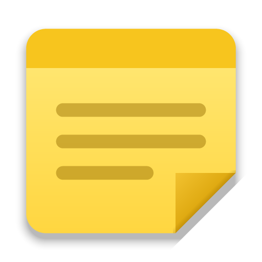

<h1>OpenStickies</h1>

<p><b>Sticky notes for Windows, macOS and Linux, rebuilt with rich text, tabs, checklists, images, version history and private notes.</b></p>

<p>
  <a href="https://github.com/ItsCetla/OpenStickies/releases/latest"></a>
  <a href="https://github.com/ItsCetla/OpenStickies/releases"></a>
  <a href="#download"></a>
  <a href="LICENSE"></a>
  <a href="https://www.electronjs.org"></a>
</p>

<p>
  <a href="https://github.com/ItsCetla/OpenStickies/releases/latest"><b>Download</b></a>
  &nbsp;·&nbsp;
  <a href="https://openstickies.cetla.dev/">Website</a>
  &nbsp;·&nbsp;
  <a href="#highlights">Features</a>
  &nbsp;·&nbsp;
  <a href="#opencode-integration">OpenCode</a> ·
  <a href="#claude-code-and-codex">Claude Code & Codex</a>
  &nbsp;·&nbsp;
  <a href="#keyboard-shortcuts">Shortcuts</a>
  &nbsp;·&nbsp;
  <a href="CHANGELOG.md">Changelog</a>
</p>

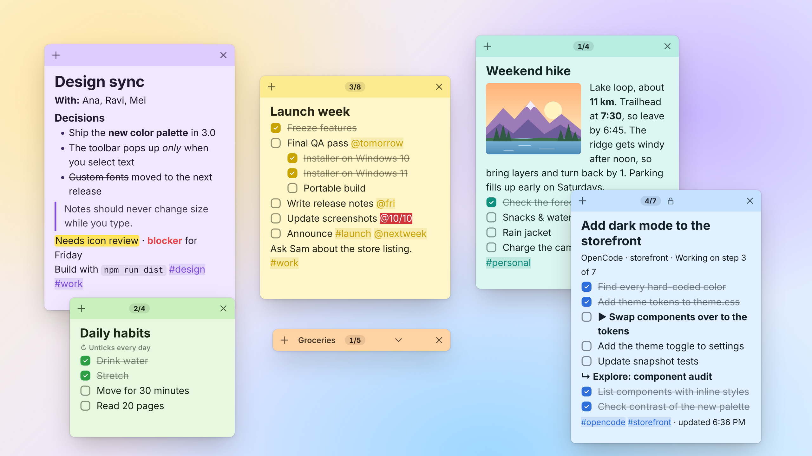

</div>

<br>

**OpenStickies** is sticky notes for Windows, macOS and Linux, rebuilt with rich formatting, tabs, code blocks, images, file shortcuts, checklists, reminders, tags, links between notes, workspaces, custom backgrounds, version history, private notes, screen snips with searchable text, and integrations for OpenCode, Claude Code and Codex. Every note is its own small floating window, like classic Stickies.

## Download

OpenStickies runs on **Windows 10 and 11**, **macOS** (Apple silicon and Intel) and **Linux** (x64). Get the latest version from the **[Releases page](https://github.com/ItsCetla/OpenStickies/releases/latest)**.

### Windows

| Build | File | What it does |
|---|---|---|
| **Installer** | `OpenStickies-Setup-<version>.exe` | Installs OpenStickies and adds Start menu and desktop shortcuts. |
| **Portable** | `OpenStickies-Portable-<version>.exe` | Runs without installing anything. |

> [!NOTE]
> The builds aren't code-signed, so Windows SmartScreen may say "Windows protected your PC". Click **More info → Run anyway**.

> [!TIP]
> OpenStickies keeps running in the **system tray** after you close every note. Windows hides new tray icons behind the **^** arrow at the right end of the taskbar; drag the yellow icon onto the taskbar to keep it in view. Click it to bring your notes back, or right-click it for more.

### macOS

| Build | File | What it does |
|---|---|---|
| **Apple silicon** | `OpenStickies-<version>-mac-arm64.dmg` | Disk image for M1 and later Macs. Drag OpenStickies to Applications. |
| **Intel** | `OpenStickies-<version>-mac-x64.dmg` | Disk image for Intel Macs. |

Both are also attached as `.zip` files (`OpenStickies-<version>-mac-arm64.zip` and `OpenStickies-<version>-mac-x64.zip`).

> [!NOTE]
> Unless a release says its Mac builds are notarized by Apple, the first time macOS may say OpenStickies can't be opened. Control-click (or right-click) OpenStickies in Applications and choose **Open**, then **Open** again. On macOS 15 and later, try to open it once, then go to **System Settings → Privacy & Security** and click **Open Anyway**. You only need to do this once.

On a Mac, OpenStickies has an icon in the menu bar, and clicking its Dock icon opens the notes list. Snipping the screen needs the **Screen Recording** permission: allow it in **System Settings → Privacy & Security → Screen & System Audio Recording**, then quit and reopen OpenStickies.

### Linux

| Build | File | What it does |
|---|---|---|
| **AppImage** | `OpenStickies-<version>-linux-x86_64.AppImage` | Runs on most distributions without installing. |
| **Debian / Ubuntu** | `openstickies_<version>_amd64.deb` | Package for `apt`. |

> [!NOTE]
> Make the AppImage executable first, then start it: `chmod +x OpenStickies-<version>-linux-x86_64.AppImage && ./OpenStickies-<version>-linux-x86_64.AppImage`. Some distributions need `libfuse2` installed to run AppImages.

On GNOME, the tray icon needs the AppIndicator extension; without a tray, OpenStickies opens its notes list instead. On Wayland, snipping the screen goes through the system's screen-sharing prompt, which needs `xdg-desktop-portal` and the portal for your desktop.

### Checking a download

Every release has a `SHA256SUMS.txt`. On macOS and Linux, run `shasum -a 256 -c SHA256SUMS.txt --ignore-missing` in the folder you downloaded to. In PowerShell, compare `Get-FileHash .\OpenStickies-Setup-<version>.exe` with the matching line.

Prefer to build it yourself? See [Build from source](#build-from-source).

## Highlights

<table>
  <tr>
    <td width="50%" valign="top">
      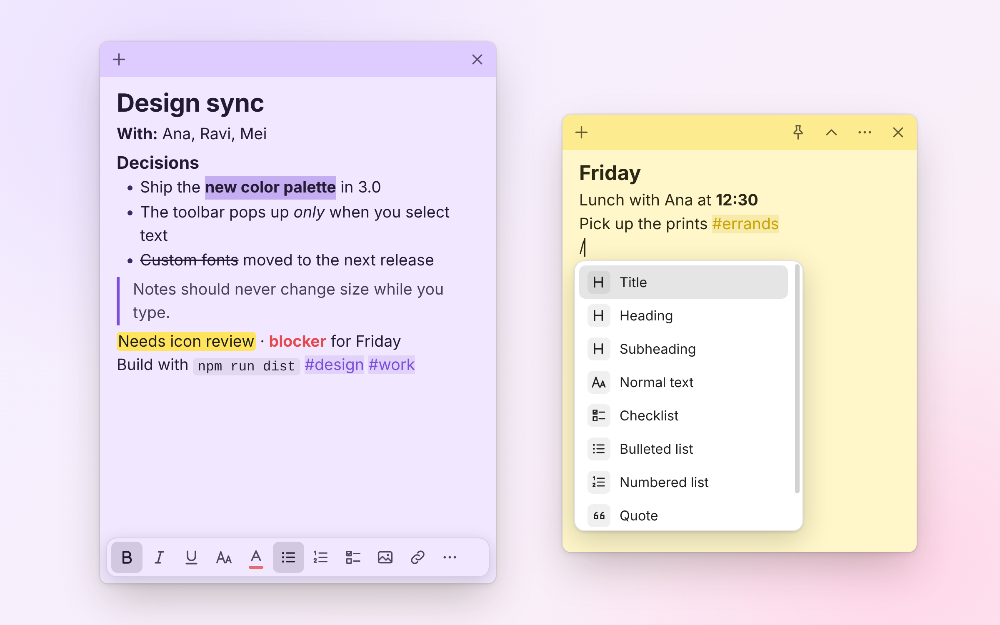
      <p align="center"><b>Rich text, Markdown shortcuts and a "/" menu for everything else.</b></p>
    </td>
    <td width="50%" valign="top">
      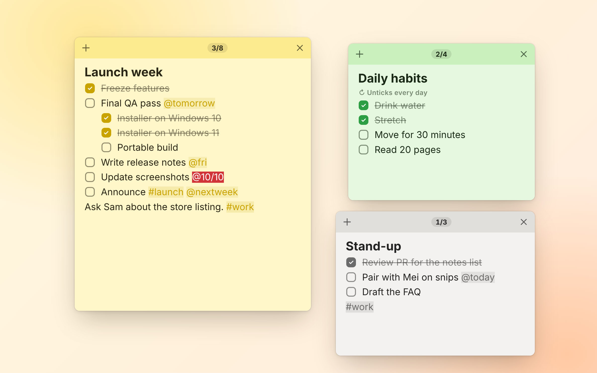
      <p align="center"><b>Nested checklists with due dates and a progress count.</b></p>
    </td>
  </tr>
  <tr>
    <td width="50%" valign="top">
      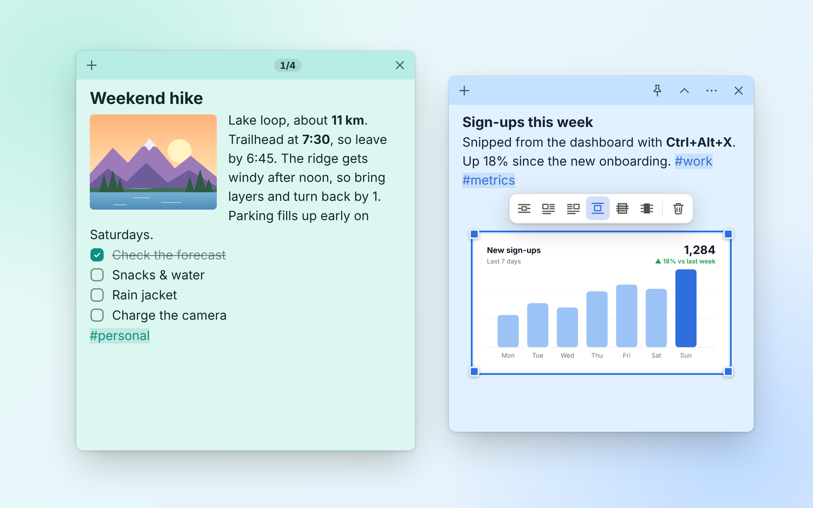
      <p align="center"><b>Pictures wrap around text, like in Word.</b></p>
    </td>
    <td width="50%" valign="top">
      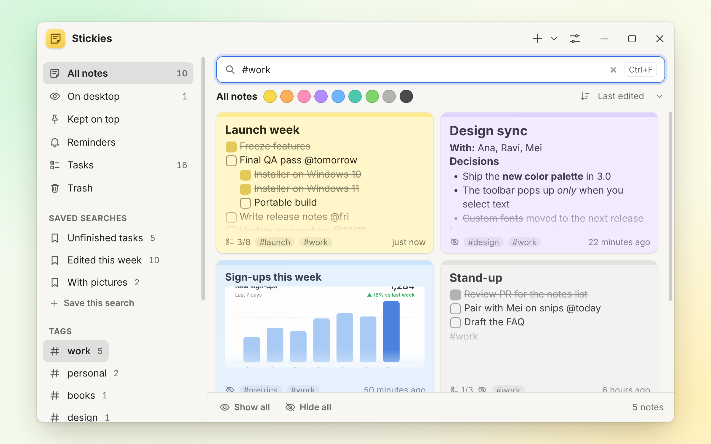
      <p align="center"><b>Find any note by its words, tags or filters.</b></p>
    </td>
  </tr>
  <tr>
    <td width="50%" valign="top">
      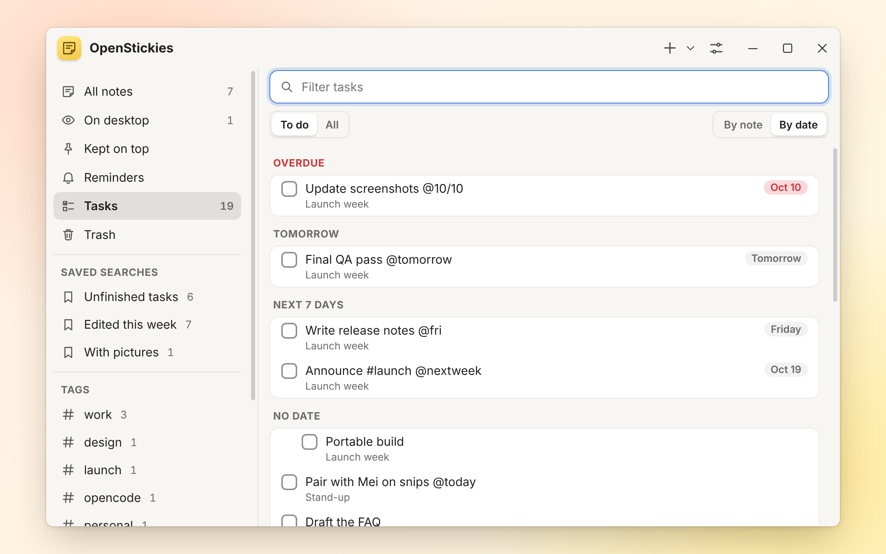
      <p align="center"><b>Every open to-do from every note, grouped by due date.</b></p>
    </td>
    <td width="50%" valign="top">
      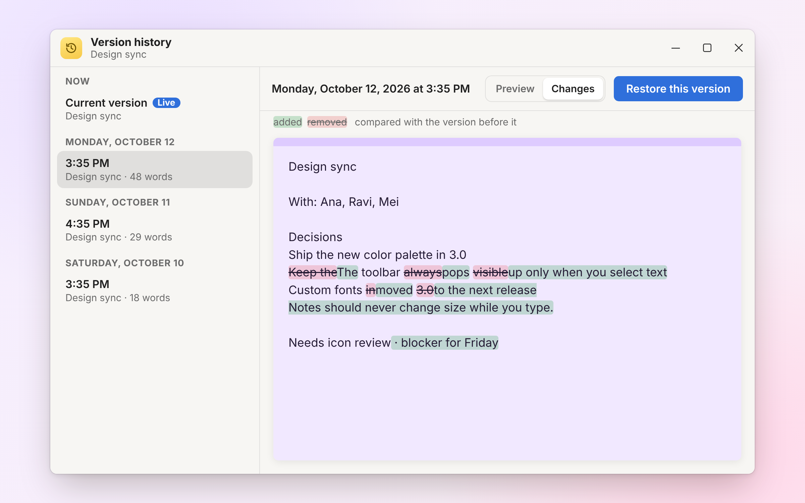
      <p align="center"><b>Version history highlights word-by-word changes.</b></p>
    </td>
  </tr>
  <tr>
    <td width="50%" valign="top">
      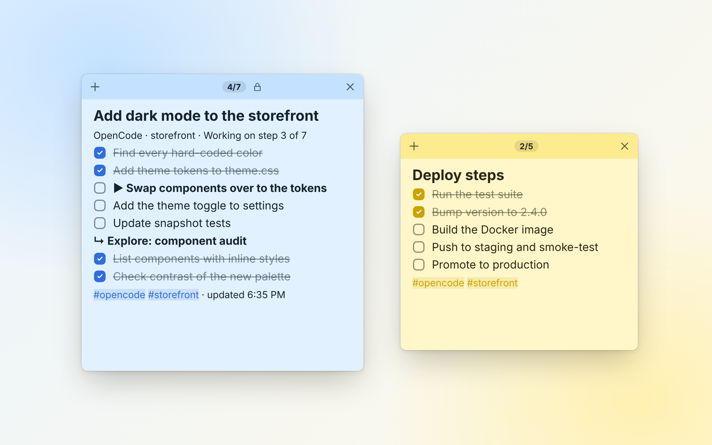
      <p align="center"><b>Follow OpenCode's plan on a live sticky as it works.</b></p>
    </td>
    <td width="50%" valign="top">
      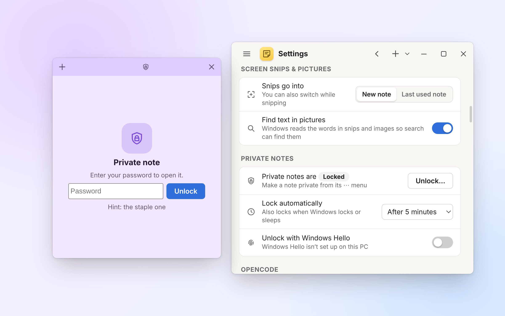
      <p align="center"><b>Private notes are encrypted and locked with your password.</b></p>
    </td>
  </tr>
  <tr>
    <td colspan="2" valign="top">
      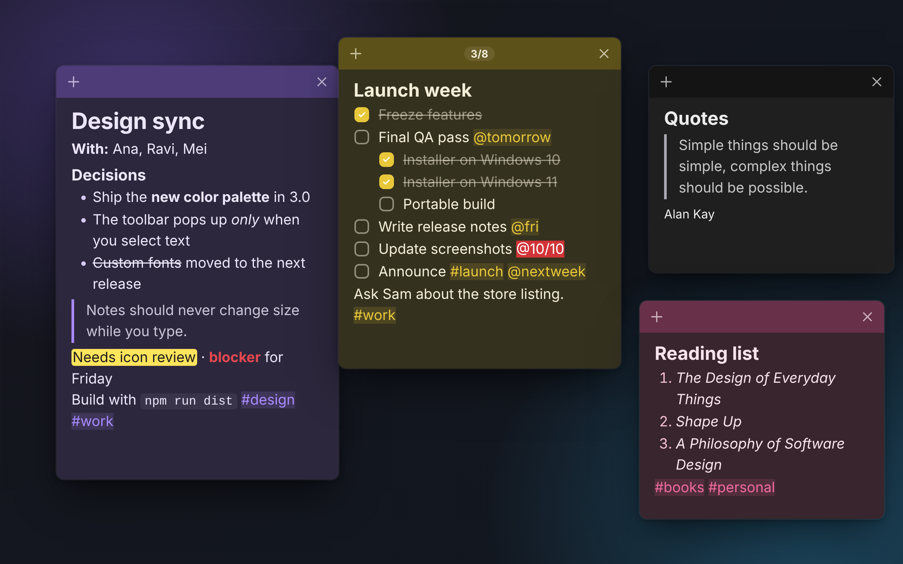
      <p align="center"><b>Light and dark themes, or follow your system.</b></p>
    </td>
  </tr>
</table>

## Writing

- **Formatting:** bold, italic, underline, strikethrough, superscript/subscript, titles and headings, quotes, code blocks, 9 text colors, 6 highlights, 5 sizes, alignment, links, tables and dividers.
- **Formatting toolbar:** by default it pops up over the bottom edge when you select text or point at the bottom of a note, so a note never changes size. Settings has **While editing** and **Always** options.
- **"/" command menu:** type `/` to insert a heading, checklist, table, image, screen snip, date, link, reminder, or one of your **templates**.
- **Edit HTML source** (Ctrl+Shift+H) to change a note's HTML directly.
- **Custom backgrounds:** give a note a solid color, a two-color gradient (with eight presets and an angle), or a picture set to **Fill**, **Fit** or **Tile** with a dimmer. The text color adjusts to stay readable.

### Tabs

- **Ctrl+Shift+T** adds a tab, up to three per note. The tab row appears once a note has two.
- Tabs name themselves from their first line until you rename them (double-click or **F2**). Drag to reorder, and close with × or a middle-click.
- Each tab keeps its own scroll position and undo history. **Ctrl+Tab** / **Ctrl+Shift+Tab** move between them (Control, not ⌘, on a Mac), and **Ctrl+1** to **3** jump to one.
- Search looks inside every tab. A closed tab goes to the Trash, and restoring it puts it back in its note (or in a new note if that one is full).

### Code blocks

- Syntax highlighting for 18 languages: plain text, JavaScript, TypeScript, Python, SQL, HTML, XML, CSS, JSON, Shell, C, C++, Java, C#, Go, Rust, YAML and Markdown.
- Start a block with ```` ```python ```` (or any of those languages), pick one from the **Code language** right-click menu, or let OpenStickies guess; a guess shows dimmed until you choose.
- The language is kept when you export to Markdown and import it back.

**Markdown-style typing** converts as you go:

| Type | To get |
|---|---|
| `# ` / `## ` / `### ` | Headings |
| `- ` | Bulleted list |
| `1. ` | Numbered list |
| `[] ` | Checklist item |
| `> ` | Quote |
| ```` ``` ```` then Enter | Code block |
| `---` then Enter | Divider |
| `**bold**`, `*italic*`, `~~strike~~`, `` `code` ``, `==highlight==` | Inline formatting |

### Checklists

- **Tab / Shift+Tab** indent and outdent items, and items keep their checkbox, ticked state and style. **Alt+Shift+↑/↓** moves an item up or down; you can also drag the grip on its left.
- **Parent and sub-items stay in sync.** Ticking a parent ticks everything under it, and once every sub-item is ticked the parent ticks itself (unticking works the same way in reverse).
- Ticked items **stay where they are**. To have them move below the unticked ones, turn on Settings → *Move ticked items to the bottom*, or right-click a checklist to do it once. A **3/8** progress count shows in the title bar.
- Right-click a checklist to make it **untick itself every day or every Monday**, which suits routines and habits, or to **remove ticked items**.
- **Due dates:** add `@today`, `@tomorrow`, `@fri`, `@nextweek`, `@+3d` or `@10/20` to an item. The date is fixed when you type it, and overdue items turn red.
- Title/Heading styles and every text effect work inside checklist items.

### Images

- Paste, drag in, insert, or **snip the screen** (Ctrl+Alt+X from anywhere, or `/snip` in a note).
- Resize from any corner. The layout bar or right-click menu sets the picture **in line with text**, **wrapped left/right**, **top and bottom**, **behind text** or **in front of text**, like Word. You can drag pictures around, and arrow keys nudge floating ones.
- **Text in pictures is searchable.** Text recognition reads snips, screenshots and photos, and the notes list finds them by those words. Right-click a picture to copy its text. It uses Windows' built-in recognition on Windows, Apple's Vision on macOS, and `tesseract` on Linux if it's installed.
- **Double-click a picture** to see it full size. Hover over a shrunken picture for a preview.

### Files

- Drop a file or folder into a note to add a **file shortcut**. Right-click it to **Open**, **Show in folder** or **Copy path**, or drag it back out into another app.
- Hover over a shortcut for a preview. On Linux the previews come from the desktop's thumbnailers, so a file previews wherever the file manager shows a thumbnail for it. Shortcuts to files that have moved or been deleted are dimmed.

## Organizing

- **Tags:** type `#project` anywhere. `#` suggests tags you've already used, and Ctrl+Click a tag to list every note that has it.
- **Links between notes:** type `[[` to link to another note by title, or to create a new one. Ctrl+Click a link to open the note, and each note's ⋯ menu shows **Linked from**.
- **Workspaces:** save the current arrangement of notes (which are open, where they are, their size, whether they're on top or rolled up) as "Work", "Home" and so on, and switch from the sidebar, the tray or **Ctrl+Alt+W**. Each workspace remembers changes when you switch away. When you plug into a dock or change monitors, OpenStickies switches to the workspace you last used with that setup.
- **Snap to grid:** turn on *Snap notes to a grid* in Settings and choose the grid size. **Locked** notes can't be moved or resized.
- **Reminders:** a countdown strip and a colored frame show a reminder coming, turning from green to orange to red as it gets close. Choose a **Reminder sound** (Chime, Soft or None) in Settings.
- **Languages:** the app runs in English, German, Spanish, French, Italian, Portuguese (Brazil), Dutch, Polish, Russian, Japanese, Chinese (Simplified) or Arabic (right to left). It follows your system language, or choose one in Settings → **Appearance → Language**. The welcome note and built-in templates stay in English.
- **Templates:** six built-in templates (meeting notes, daily plan, daily habits, weekly review, packing list, shopping list). Turn any note into one from its ⋯ menu with **Save as template…**. Templates fill in `{{date}}`, `{{time}}`, `{{weekday}}`, `{{week}}` and `{{tomorrow}}`, and `{{cursor}}` marks where typing starts.

### Notes list, search and tasks

The **notes list** (Ctrl+H) has a sidebar with:

- views: All, On desktop, Kept on top, Reminders, **Tasks**, Trash
- your saved searches
- your tags
- your workspaces

Its search understands these filters:

| Filter | Example |
|---|---|
| A tag | `#work` |
| Notes with unfinished checklists | `has:unchecked` |
| Notes with pictures | `has:image` |
| Recent edits | `edited:today`, `edited:week`, `edited:3d` |
| Due dates | `due:today`, `due:week`, `due:overdue` |
| On the desktop / kept on top | `is:open`, `is:pinned` |
| By color | `color:blue` |
| An exact phrase | `"call back"` |

Click **Save this search** to keep a search in the sidebar. Matches are highlighted in the list and in the note.

**Tasks** shows every unticked checklist item from every note, grouped by note or by due date. Tick items right there and the note updates, even if it's closed. Click an item to jump to it.

## Safety

- **Version history:** OpenStickies keeps a snapshot whenever you come back to a note after a few minutes away. ⋯ → **Version history…** shows a timeline, previews old versions, highlights word-by-word **changes**, and restores any version. The current text stays in the history, so a restore can be undone.
- **Trash** keeps your latest 300 deleted notes and 300 closed tabs. Nothing is removed because of its age, only once the Trash is full. Daily backups cover the last 14 days, and saves are crash-safe.
- **Backup & restore** puts every note, image and template in one file (private notes stay encrypted).
- **Export** every note at once as Markdown (one `.md` file per note, pictures in an `assets` folder), text or JSON. A single note exports as HTML, Markdown, text, PDF or JSON, or prints.

### Private notes

Set a password in Settings, then use ⋯ → **Make private…** on any note.

- Its words, pictures and background image are encrypted on disk (AES-256-GCM, with the key protected by your password via scrypt).
- While locked, private notes are hidden from search, previews and exports.
- They lock automatically after a set idle time, and when your computer locks or sleeps.
- Windows Hello (Windows) or Touch ID (macOS) can unlock them if it's set up. On Linux, you unlock them with the password.

> [!WARNING]
> If you forget the password, private notes can't be recovered.

## OpenCode integration

While [OpenCode](https://opencode.ai) works on a multi-step task, a sticky on your desktop shows its plan:

- the steps it has finished are ticked, and the step it's on is marked ▶
- the steps still to do stay open, so you can see where it's going
- sub-agents' lists appear as sections of the same note
- a status line says *Working on step 3 of 7*, *Waiting for you*, *All 7 steps done* or *Stopped with an error*

### Connect OpenCode

1. In OpenStickies: **Settings → OpenCode → Connect**. This adds a small plugin to `~/.config/opencode/plugins/`.
2. Restart OpenCode.

Task notes are blue (you can change the color), locked so typing can't clash with the agent, and tagged `#opencode` plus the project name. Quick questions without a plan don't create a note, and a task note you delete stays deleted. **Disconnect** removes the plugin.

**Every multi-part task gets a sticky.** While OpenStickies is running, the plugin adds a standing instruction for the agent: any request with two or more distinct subtasks gets a to-do list first, which then appears as a sticky. One-item lists don't create a note. Turn this off with **Settings → OpenCode → Always plan multi-part tasks**; the change applies right away.

### Notes on request: the agent's OpenStickies tools

The plugin also gives the agent four tools, so you can just ask, e.g. *"put the deploy steps on a sticky"* or *"make me a checklist sticky for this refactor and tick items off as you go"*:

| Tool | What it does |
|---|---|
| `stickies_create` | New sticky with a title and Markdown content (`- [ ]` makes a checkbox), optional color and tags |
| `stickies_update` | Replace the content, append to it, rename it or change its color |
| `stickies_check` | Tick or untick a checklist item by its text or number |
| `stickies_list` | List the stickies the agent has made (with ids), e.g. to continue one from an earlier session |

The agent can only change stickies **it** created. It can't read, change or tick your own notes, and a sticky you delete can't be edited back. If OpenStickies isn't running, the tools tell the agent to ask you to start it.

## Claude Code and Codex

The same task notes work with [Claude Code](https://claude.com/claude-code) and [Codex](https://openai.com/codex). Connect each one from Settings; the task-note color and the planning rule are the ones set under **Settings → OpenCode**, and apply to every connected agent.

### Connect Claude Code

1. In OpenStickies: **Settings → Claude Code → Connect**.
2. Restart Claude Code.

Connecting copies two small scripts to `~/.stickies/agents/` and registers them: an MCP server with the `stickies_*` tools (in `~/.claude.json`) and a hook (in `~/.claude/settings.json`, for the UserPromptSubmit, PostToolUse, Stop and SessionEnd events) that mirrors Claude Code's own to-do list to a sticky: the first thing you asked becomes the title, done steps are ticked and the current one is marked ▶. The hook never blocks the agent, and it leaves your other hooks alone. Task notes are tagged `#claude-code` plus the project name. **Disconnect** removes the hook and the server.

### Connect Codex

1. In OpenStickies: **Settings → Codex → Connect**.
2. Restart Codex.

Connecting adds a block to `~/.codex/config.toml` (between `# BEGIN OpenStickies` and `# END OpenStickies`) with the same MCP server, plus a `stickies_plan` tool, since Codex's to-do list isn't visible from outside: the agent is asked to put its plan on a sticky before any multi-part task and to keep it current as it works. Task notes are tagged `#codex` plus the project name. **Disconnect** removes the block.

The scripts need Node (18 or later) on your PATH. Without it, OpenStickies registers its own runtime to run them.

Both agents get the same four tools as OpenCode (`stickies_create`, `stickies_update`, `stickies_check` and `stickies_list`), with the same rule: they can only change stickies they created.

### Local API

Under the hood, OpenStickies runs a small local API on `127.0.0.1` with a random port and a token stored in `~/.stickies/api.json` (`%USERPROFILE%\.stickies\api.json` on Windows), with a copy as `api.json` in the [data folder](#where-your-notes-live). Requests from web pages are refused. Scripts can use it too.

<details>
<summary><b>Example request and endpoints</b></summary>

<br>

```bash
curl -X POST http://127.0.0.1:PORT/v1/notes -H "Authorization: Bearer TOKEN" -H "Content-Type: application/json" -d "{\"title\":\"From a script\",\"content\":\"- [ ] one\\n- [x] two\"}"
```

| Endpoint | Purpose |
|---|---|
| `POST /v1/notes` | Create a note (title, Markdown content, optional color and tags) |
| `GET /v1/notes` | List notes created through the API (never your own) |
| `PATCH /v1/notes/:id` | Replace, append to, rename or recolor a note created through the API |
| `POST /v1/notes/:id/check` | Tick or untick a checklist item by its text or number |
| `PUT /v1/agent/:key` | Create or update an AI task note |
| `GET /v1/ping` | Check that OpenStickies is running (no token needed) |

</details>

## Keyboard shortcuts

On a Mac, read **Ctrl** as **⌘** and **Alt** as **⌥** (Ctrl+Alt+N is ⌥⌘N), except where it says Control. OpenStickies shows them that way in its menus and settings.

**Anywhere on your desktop** (you can change these in Settings)

| Shortcut | Action |
|---|---|
| Ctrl+Alt+N | New note |
| Ctrl+Alt+X | Snip the screen into a note |
| Ctrl+Alt+S | Bring all notes to the front |
| Ctrl+Alt+H | Show / hide all notes |
| Ctrl+Alt+W | Next workspace |

**In a note**

| Shortcut | Action |
|---|---|
| Ctrl+N / Ctrl+W / Ctrl+D | New / close / delete note |
| Ctrl+H | Notes list |
| Ctrl+Shift+T | New tab |
| Ctrl+Tab / Ctrl+Shift+Tab | Next / previous tab (Control on a Mac too) |
| Ctrl+1 / 2 / 3 | Go to a tab |
| F2 | Rename the current tab |
| Ctrl+B / I / U / T / E | Bold / italic / underline / strikethrough / inline code |
| Ctrl+Shift+L / O / C | Bulleted / numbered list / checklist |
| Ctrl+Alt+1 / 2 / 3 / 0 | Title / heading / subheading / normal text |
| Tab / Shift+Tab | Indent / outdent (list items, table cells) |
| Alt+Shift+↑ / ↓ | Move a list item |
| Ctrl+K | Link |
| Ctrl+F | Find in note |
| Ctrl+Shift+H | Edit HTML source |
| Ctrl+Shift+V | Paste as plain text |
| Ctrl+Shift+P | Keep on top |
| Ctrl+Shift+R | Roll up / unroll (or double-click the title bar) |
| Ctrl+= / Ctrl+- / Ctrl+0 | Zoom in / out / reset |
| Ctrl+P | Print |
| Ctrl+Click | Open a link, linked note or #tag |

## Where your notes live

Everything stays on your computer, in a `data` folder. Settings → **Open data folder** takes you there.

| System | Folder |
|---|---|
| Windows | `%APPDATA%\OpenStickies\data\` |
| macOS | `~/Library/Application Support/OpenStickies/data/` |
| Linux | `~/.config/OpenStickies/data/` |

**Keeping your notes somewhere else.** Settings → **Where your notes live → Change…** moves your notes, pictures, history, backups, settings and templates to a folder you choose, such as one synced with Dropbox, OneDrive or iCloud Drive. **Use default** moves them back. If the folder is synced, run OpenStickies on only one computer at a time. A small `data-location.json` in the default folder remembers your choice.

> [!NOTE]
> **Upgrading from Stickies?** The app used to be called Stickies and kept its notes in `%APPDATA%\Stickies\data\`. The first time OpenStickies starts, it copies them across automatically, along with your pictures, version history, settings and templates. The old folder is left in place as a backup (with a note saying so); delete it once you've checked everything is there. The installer also replaces an installed copy of Stickies, so you don't end up with both.

<details>
<summary><b>What's in that folder</b></summary>

<br>

- `notes.json`: your notes
- `settings.json`: your preferences
- `templates.json`: your templates
- `vault.json`: the private-notes key, wrapped by your password
- `attachments`: images; private ones end in `.enc`, and cached recognized text ends in `.txt`
- `history`: version history
- `backups`: daily copies of `notes.json`
- `api.json`: the local API port and token, written while OpenStickies runs (also to `~/.stickies/api.json`, which Windows never redirects; see below). It stays in the default folder even if you move your notes.

**Windows: started from a packaged app?** If OpenStickies is started by a packaged Windows app (for example from a terminal inside Claude Desktop), Windows redirects everything it writes to AppData into that app's private folder (`%LOCALAPPDATA%\Packages\<app>\LocalCache\Roaming\OpenStickies\`). That copy of OpenStickies then has its own notes, separate from the ones you see when you start it from the Start menu.

</details>

## Build from source

You need [Node.js](https://nodejs.org) 20 or newer.

```bash
git clone https://github.com/ItsCetla/OpenStickies.git
cd OpenStickies
npm install
npm start
```

| Command | What it does |
|---|---|
| `npm install` | Installs dependencies and also downloads Electron itself, through the project's `postinstall` script (npm 11 no longer runs dependencies' install scripts on its own) |
| `npm start` | Runs OpenStickies |
| `npm run dev` | Runs with DevTools turned on (Ctrl+Shift+I in a note) |
| `npm run dist` | Builds the Windows installer and portable app into `dist/` |
| `npm run dist:mac` | Builds the Mac disk images and `.zip` files into `dist/` |
| `npm run dist:linux` | Builds the Linux AppImage and `.deb` into `dist/` |

Build each platform on that platform; the [release workflow](.github/workflows/release.yml) does this on Windows, macOS and Linux runners.

Starting OpenStickies with `--quit` (for example `OpenStickies.exe --quit` on Windows) closes a running copy cleanly (it saves first).

### Project layout

<details>
<summary><b>Show the source tree</b></summary>

<br>

```
src/
  main/                  Electron main process
    main.js              lifecycle, protocols, IPC, hotkeys, private-note encryption, checklist resets
    windows.js           note windows, workspace layouts, notes list and history windows
    store.js             saving (atomic + fsync, backups, recovery), templates, image attachments
    store-text.js        plain-text helpers shared by the store and the HTML scanners
    html-scan.js         tags, links, task counts and checklist resets from HTML, without a DOM
    history.js           version history snapshots
    vault.js             private notes: key wrapping, AES-GCM, Windows Hello and Touch ID
    workspaces.js        saved layouts and monitor-setup switching
    snip.js              screen snips (with macOS and Wayland permission handling)
    ocr.js               text in pictures: Windows OCR, macOS Vision or Tesseract on Linux
    files.js             file shortcuts: opening, revealing, dragging out, previews
    data-location.js     the custom data folder
    migrate.js           one-time copy from the old Stickies folder
    api-server.js        local API for the AI agents and scripts
    agent-notes.js       AI task notes (OpenCode, Claude Code, Codex)
    opencode.js          installs/removes the OpenCode plugin
    agents.js            connects Claude Code (hook + MCP server) and Codex (MCP server)
    i18n.js              loads the interface language for the main process
    reminders.js, exporter.js, markdown.js, context-menu.js, tray.js
  integrations/
    opencode-plugin.js   the plugin that runs inside OpenCode
    stickies-mcp.mjs     the MCP server Claude Code and Codex talk to
    claude-hook.mjs      the hook that mirrors Claude Code's to-do list
  locales/               interface strings, one JSON file per language (en.json is the reference)
  preload.js             the safe API the windows are allowed to use
  renderer/
    note/                editor engine, tabs, "/" "#" "[[" suggestions, smart checklists,
                         code highlighting, file chips, lock screen
    manager/             notes list, sidebar, tasks, settings
    history/             version history window
    snip/                screen snip overlay
    lightbox/            full-size picture viewer
    shared/              palette, icons, backgrounds, shortcut labels, reminders, translations, HTML sanitizer, HTML → Markdown
```

</details>

## Contributing

Bug reports, ideas and pull requests are welcome. Please read [CONTRIBUTING.md](CONTRIBUTING.md) before you start, and see [CHANGELOG.md](CHANGELOG.md) for what changed in each release.

## Security

Every window is sandboxed with context isolation, a strict Content-Security-Policy blocks scripts in note content, and everything pasted, dropped, imported or typed into the HTML source editor goes through an allowlist sanitizer.

To report a vulnerability, see [SECURITY.md](SECURITY.md).

## License

OpenStickies is released under the MIT License. See [LICENSE](LICENSE).
